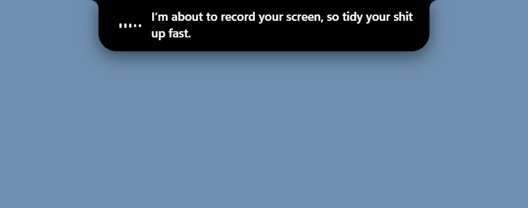

# heads-up

Make any AI agent talk to you **out loud** before it does something that needs you: take a screenshot, record your
screen, grab your mouse, ask a question. A buttery OLED-style **notch** drops from the top of your main display and
types out what was said.



- **Agent-agnostic.** It's a plain CLI: `heads-up "about to record your screen"`. Claude Code, Codex, Gemini CLI,
  Aider, OpenCode, shell scripts, cron jobs: anything that can run a command can speak. A ready-made hook adapter
  for Claude Code is included.
- **Live voice from OpenAI's Realtime API** (`gpt-realtime-2.1` by default). You pass a plain description; the model
  words it in its own persona (friendly and foul-mouthed by default, swap it with `--persona`) and speech starts
  streaming in about a second.
- **The notch.** Pure black, flush with the top edge, concave ears, rounded bottom corners. Width and height are
  springs integrated against the real frame time, so the motion is the same at 60 Hz and runs at the full refresh
  rate of fast panels (measured **499.7 fps average, 2.2 ms p99 frame time** on a 499 Hz OLED). Words ease in as
  they are spoken, and a little waveform reacts to the actual audio.
- **A queue.** Several agents talking at once never overlap; lines are spoken one after another.
- **Safe by default.** Your key never touches the repo, the overlay loads only a local file, hooks never fail loudly.

## Quick start

Requires Node 22+ and an [OpenAI API key](https://platform.openai.com/api-keys). The notch is built and tested on
Windows 11.

```bash
git clone https://github.com/Cartterr/heads-up.git
cd heads-up
npm install
```

Give it a key, any one of these:

```bash
export OPENAI_API_KEY=sk-...                 # env var
export HEADSUP_KEY_FILE=/path/to/keyfile     # a file containing only the key
mkdir -p ~/.heads-up && echo sk-... > ~/.heads-up/key
```

Say something (the first run downloads Electron, ~100 MB, so it takes a moment):

```bash
node src/cli.mjs --wait "the build just finished"
```

Optionally `npm link` to get a global `heads-up` command.

## CLI

```
heads-up "<what to say>"
  --wait              block until the line has been spoken (default: returns once the audio is streaming)
  --detach            return immediately and speak in the background
  --debounce key:sec  skip if the same key spoke in the last <sec> seconds (default 45)
  --hook <agent>      read an agent's hook JSON on stdin instead of text (claude-code); debounced, never fails
  --no-notch          audio only, no overlay
  --voice <name>      voice (default marin, env HEADSUP_VOICE)
  --model <id>        Realtime model (default gpt-realtime-2.1, env HEADSUP_MODEL)
  --persona "<text>"  replace the system prompt (env HEADSUP_PERSONA)
  --stop              close the overlay daemon
```

Lines are capped at 300 characters. The overlay daemon starts on first use, queues speech, and quits itself after 30
idle minutes.

### Personas

The default persona is a warm, foul-mouthed best friend. To change it:

```bash
heads-up --persona "You are a polite British butler. Announce the heads-up in one short, courteous sentence." "about to record your screen"
```

## Using it from an agent

**Any agent**: put this in its instructions file (`AGENTS.md`, `CLAUDE.md`, `GEMINI.md`, ...):

```md
Before anything that needs me physically (a button to press, a login, a recording, taking over my mouse), run
`heads-up --wait "<one plain sentence with the real details>"`. Never for routine progress.
```

**Claude Code**: announce screenshots, computer use, questions and permission prompts automatically with hooks in
`~/.claude/settings.json` (adjust the matcher to your tools):

```json
{
  "hooks": {
    "PreToolUse": [{
      "matcher": "AskUserQuestion|mcp__.*__(Screenshot|Snapshot|Click|Type|computer)",
      "hooks": [{ "type": "command", "command": "node /path/to/heads-up/src/cli.mjs --hook claude-code --wait", "timeout": 25 }]
    }],
    "Notification": [{
      "hooks": [{ "type": "command", "command": "node /path/to/heads-up/src/cli.mjs --hook claude-code", "timeout": 10 }]
    }]
  }
}
```

`--wait` on `PreToolUse` makes the agent hold for the speech so you really do get ready first. A burst of clicks
announces once (debounced 45 s per kind). The hook adapter never exits non-zero, so a failure can never block the agent.

Another agent with hooks? Add a function to [`src/adapters.mjs`](src/adapters.mjs) that maps its payload to
`[debounce key, text]`, or just call `heads-up "text"` from its hook.

## How it works

```
agent ──▶ heads-up CLI ──▶ OpenAI Realtime (WebSocket)
                │              audio + transcript deltas stream back
                ▼
        overlay daemon (Electron, local named pipe)
        queue ▸ gapless Web Audio ▸ spring-driven canvas notch
```

- The CLI streams audio and transcript chunks to the daemon as they arrive. The daemon plays them back to back on
  the audio clock (sample-accurate, no gaps) and reveals words at the pace of the speech.
- The notch is one canvas drawn every animation frame; there is no CSS animation and no fixed frame budget.
- Without Electron (or with `--no-notch`) it falls back to audio only: Windows `SoundPlayer`, macOS `afplay`,
  Linux `aplay`. Only Windows is tested. On macOS and Linux the notch overlay is untested.

## Security and privacy

- The API key is read from your env or a file you point at. It is never logged, printed, or sent anywhere except
  OpenAI. The repo ignores `.env`, `*.key` and `openaikey*`.
- The text you pass, and what the model says back, go to OpenAI. Don't pipe secrets through it.
- The daemon listens on a local named pipe (`\\.\pipe\heads-up-<user>` on Windows, a socket in the temp dir
  elsewhere). Any local process of yours can make it speak; that's all it can do.
- The overlay window only loads its own `index.html` under a strict CSP. It has Node access for the socket and audio,
  so don't point it at remote content.
- Each line costs a little (Realtime audio output is billed per token; check OpenAI's pricing). Lines are capped at
  300 characters and hook announcements are debounced.

## Troubleshooting

- Nothing plays: see `~/.heads-up/heads-up.log`.
- Check the frame rate: set `HEADSUP_DEBUG_DIR=<dir>` and speak once. It writes `notch.png` and `stats.json` there.
- Overlay too slow to appear the first time: Electron is downloading. Run any `heads-up --wait "test"` once.

## Tests

```bash
npm test
```

An offline smoke test covering the hook mapping and key lookup. Playing audio and drawing the notch need a real key
and a display, so those are checked by hand.

## License

MIT
